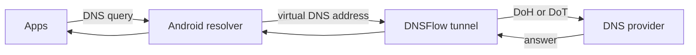

<div align="center">

# DNSFlow

**A modern Android DNS client with DNS over HTTPS (DoH) and DNS over TLS (DoT).**

[


](https://github.com/Mireli5656/DNSFlow/actions/workflows/build.yml)
[


](LICENSE)


</div>

> [!WARNING]
> DNSFlow is in **beta**. It is the first public version and has had limited testing on real devices. Please report problems in [Issues](../../issues).

## What it does

DNSFlow encrypts the DNS queries of your whole device. It uses Android's `VpnService` to catch DNS queries, sends them to the resolver you choose over DoH or DoT, and hands the answers back to your apps.

It is **not** a full VPN. Only DNS traffic enters the tunnel. The rest of your traffic is never routed through it.



## Features

- **DoH and DoT**, switchable with one tap. DoH follows RFC 8484 and uses HTTP/2. DoT follows RFC 7858.
- **Six built-in providers** and support for your own custom server.
- **Whole-device DNS routing** through `VpnService`: UDP and TCP, IPv4 and IPv6.
- **Strict TLS**: certificates and host names are always verified. Verification is never disabled.
- **Network change handling**: connections are reset when you switch between Wi-Fi and mobile data.
- **Failure handling**: if the resolver cannot be reached, apps get a normal DNS failure instead of a hang.
- **No logging, no analytics, no ads, no accounts.**
- Dark Material 3 interface built with Jetpack Compose.
- Lightweight: the only third-party dependency is OkHttp (used for DoH).

## Providers

| Provider | DoH | DoT | Notes |
| --- | --- | --- | --- |
| Cloudflare | `https://cloudflare-dns.com/dns-query` | `one.one.one.one` | No filtering |
| Google Public DNS | `https://dns.google/dns-query` | `dns.google` | No filtering |
| Quad9 | `https://dns.quad9.net/dns-query` | `dns.quad9.net` | Blocks known malicious domains |
| NextDNS | `https://dns.nextdns.io/` | `dns.nextdns.io` | Public endpoint without a profile, no filtering |
| AdGuard DNS | `https://dns.adguard-dns.com/dns-query` | `dns.adguard-dns.com` | Blocks ads, trackers and malware |
| Control D | `https://freedns.controld.com/p2` | `p2.freedns.controld.com` | Blocks malware and ads |

For your own NextDNS profile, choose **Custom server** and enter `https://dns.nextdns.io/<your-id>`.

## Install

1. Open the [Releases](../../releases) page and download `DNSFlow-<version>.apk` from the latest release.
2. Allow **Install unknown apps** for your browser or file manager when Android asks.
3. Open DNSFlow, tap **Connect**, and accept Android's VPN request.

DNSFlow needs **Android 8.0 (API 26) or newer**.

> [!NOTE]
> Beta builds are signed with a debug key that changes between builds. Updating to a later beta may require uninstalling the previous one first. Each release also includes a `.sha256` file so you can check the download.

## Usage

- **Connect / Disconnect**: the large round button on the main screen, or **Disconnect** in the notification.
- **Protocol**: pick **DoH** or **DoT** on the main screen.
- **Provider**: open **Settings** (gear icon) and pick a provider or enter a custom server.
- **IPv4 / IPv6**: choose which IP versions DNSFlow handles. At least one must stay on.

Changing a setting while connected restarts the tunnel with the new setting.

To check that it works with the Cloudflare provider selected, open [1.1.1.1/help](https://1.1.1.1/help). It reports whether your DNS queries use DoH or DoT.

## Privacy

- DNSFlow does not log or store your DNS queries.
- There are no analytics, ads or accounts, and DNSFlow talks to no server except the resolver you choose.
- Queries go to the resolver over an encrypted connection. The resolver you choose can see them and is covered by its own privacy policy.
- Settings are stored only on your device.

### Permissions

| Permission | Why |
| --- | --- |
| `INTERNET` | Send queries to your chosen resolver |
| `ACCESS_NETWORK_STATE` | Notice network changes |
| `FOREGROUND_SERVICE` | Keep the VPN running with a notification |
| `POST_NOTIFICATIONS` | Show that notification on Android 13+ (optional) |
| VPN permission | Granted through Android's own VPN dialog |

## Limitations

- Apps or devices that use their own hard-coded DNS server or their own DoH are not affected by DNSFlow.
- Android's **Private DNS** setting must be **Off** or **Automatic**. In **Strict** mode Android uses its own DoT server and bypasses DNSFlow.
- Android allows one active VPN at a time. Starting another VPN app turns DNSFlow off.
- Fragmented IPv4 packets and IPv6 packets with extension headers are ignored. DNS queries do not normally use them.
- Not supported: DNS over QUIC, DoH over HTTP/3, blocklists, and per-app rules.

## Build from source

DNSFlow is built entirely with GitHub Actions, so no PC or Android Studio is needed.

1. Fork the repository.
2. Open **Actions**, then **Build DNSFlow**, then **Run workflow**.
3. When it finishes, download the APK from the **Artifacts** section of the run.

To build locally you need JDK 17, Android SDK platform 34 with build tools 34.0.0, and Gradle 8.7. The repository has no Gradle wrapper.

```bash
gradle assembleDebug
```

The APK is written to `app/build/outputs/apk/debug/app-debug.apk`.

## Project structure

```text
DNSFlow/
├── .github/workflows/
│   ├── build.yml            # Builds the debug APK on every push
│   └── release.yml          # Attaches an APK to a published release
├── app/
│   ├── build.gradle.kts
│   └── src/main/
│       ├── AndroidManifest.xml
│       ├── res/             # Strings, colors, theme, vector icons
│       └── java/com/dnsflow/app/
│           ├── MainActivity.kt   # Entry point, VPN permission flow
│           ├── config/           # Providers, DNS config, settings storage
│           ├── dns/              # DNS message parser, DoH and DoT resolvers
│           ├── vpn/              # VpnService, packet and TCP handling
│           ├── network/          # Network change monitoring
│           ├── state/            # Connection state
│           └── ui/               # Compose screens, components, theme
├── build.gradle.kts
├── settings.gradle.kts
├── gradle.properties
├── LICENSE
└── README.md
```

## Tech stack

Kotlin, Jetpack Compose, Material 3, Android `VpnService`, OkHttp (DoH), Java `SSLSocket` (DoT), Gradle Kotlin DSL, GitHub Actions, JDK 17.

## Versioning

Releases follow [Semantic Versioning](https://semver.org). Test builds are published as pre-releases named like `v0.1.0-beta.1`. The first stable release will be `v1.0.0`.

## Contributing

Bug reports, ideas and pull requests are welcome. Please keep the app lightweight: no analytics, no logging of DNS queries, and no benchmarking features.

## License

DNSFlow is released under the [MIT License](LICENSE).
